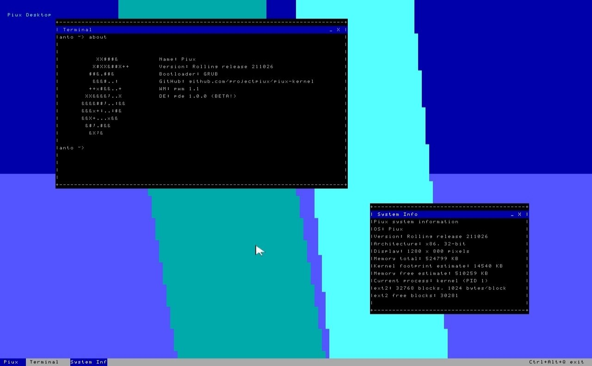

<div align="center">


# Piux

**A small, Unix-like operating system for 32-bit x86, written from scratch.**


[Overview](#-overview) •
[Quick Start](#-quick-start) •
[Running](#-running) •
[Interfaces](#-interfaces) •
[Under the Hood](#-under-the-hood) •
[Community](#-community) •
[Contributing](#-contributing)

<br>



<sub>The PDE desktop running on Piux in QEMU.</sub>

<br>

[Thank you, contributors! <3](THANK-YOU-CONTRIBUTORS.md)

</div>

---

## ✨ Overview

Piux is an experimental operating system built to be **read, understood and modified**. It boots through GRUB, switches to a 1280×720 framebuffer, mounts a real ext2 disk and starts **PDE**, its desktop environment, all written in freestanding C and NASM. Prefer a keyboard-driven setup? Switch to **pWM**, the alternative tiling window manager.

It follows a rolling-release model with stable ISO snapshots, and every commit can be built into a working system.

| | |
|---|---|
| 🧠 **Kernel** | 32-bit protected mode with paging, interrupts, a timer and user-mode support |
| 💾 **Storage** | ATA disk driver and a read/write ext2 filesystem behind a Unix-like VFS |
| 🖥️ **Graphics** | Native 1280×720 32-bit framebuffer with software rendering and double buffering |
| 🪟 **Interfaces** | PDE (default desktop) and pWM (alternative tiling window manager) |
| 🔐 **Accounts** | First-boot installer, login and hashed passwords |
| 🌐 **Network** | RTL8139 driver and a minimal IP stack, with a built-in package manager |

> Piux is a learning-oriented project. It is not meant to replace a mature operating system, and its security model is experimental.

---

## 🚀 Quick Start

```bash
git clone https://github.com/madebyanto/piux-kernel.git
cd piux-kernel
bash fast-all.sh
```

`fast-all.sh` is an interactive TUI that builds Piux and boots it in QEMU. It can also create a fresh ext2 disk image or open an existing one. To clean previous build output:

```bash
make clean
```

### Prerequisites

<details open>
<summary><b>Debian / Ubuntu</b></summary>

```bash
sudo apt-get install nasm gcc binutils grub-pc-bin xorriso qemu-system-x86 e2fsprogs
```
</details>

<details>
<summary><b>Fedora / RHEL</b></summary>

```bash
sudo dnf install nasm gcc binutils grub2-tools xorriso qemu-system-x86 e2fsprogs
```
</details>

<details>
<summary><b>macOS (Homebrew)</b></summary>

```bash
brew install nasm gcc binutils grub xorriso qemu e2fsprogs
```
</details>

### System requirements

| Resource | Minimum |
|---|---|
| CPU | 32-bit x86 / i386-compatible |
| RAM | 24 MiB |
| Disk | 32 MiB |
| Firmware | BIOS / legacy boot with GRUB Multiboot1 |
| Video | Multiboot framebuffer with a supported graphics mode |

> These are the project's target minimums. The default QEMU setup uses more.

---

## 🏃 Running

### QEMU

`fast-all.sh` boots Piux for you. To run an existing ISO manually (without a disk, Piux falls back to an in-memory filesystem):

```bash
qemu-system-i386 \
  -cdrom piux.iso \
  -m 512M \
  -vga none \
  -device VGA,xres=1280,yres=720
```

### Real hardware

Piux is technically bootable on real x86 hardware, but this is **strongly discouraged**: it has not been tested on physical machines and is not mature enough yet. Use QEMU instead.

> ⚠️ Booting on real hardware is at your own risk. If you still want to try, writing the ISO to a USB drive with `dd` **erases** the target device, so double-check the device path.

---

## 💻 Using Piux

On first boot with a blank disk, a keyboard-driven **installer** sets up the filesystem and your account. After that, you log in and land in the default desktop.

```text
Welcome to Piux!

user@piux> help
```

Type `help` at any time to list the available commands.

---

## 🪟 Interfaces

Piux ships with two user interfaces, both running on the same kernel and sharing the same command set.

| Interface | Role | Description |
|---|---|---|
| **PDE** | Default | The Piux Desktop Environment: a mouse and keyboard desktop rendered directly into the framebuffer. |
| **pWM** | Alternative | A minimal tiling window manager inspired by tiled desktops. Terminals are arranged automatically to fit the screen, with keyboard and mouse focus. |

---

## 🏗️ Under the Hood

**Boot.** BIOS hands over to GRUB, which loads the Piux kernel through Multiboot1 and passes along the framebuffer information. The kernel initializes its subsystems, mounts ext2 when a disk is available, runs the installer if needed, authenticates the user and starts the desktop.

```text
BIOS ─▶ GRUB ─▶ Piux kernel ─▶ ext2 mount ─▶ installer / login ─▶ PDE / pWM
```

**Filesystem.** Everything is exposed through a Unix-like VFS with file descriptors and device nodes such as `/dev/console` and `/dev/hda`. The ext2 driver is non-journaled and supports direct, single- and double-indirect blocks, file creation, reading, writing and deletion. Without a disk, Piux falls back to RAMFS.

**Processes.** The kernel provides `int 0x80` syscalls, a kernel/user GDT with TSS, and a loader for ring3 ELF binaries. Scheduling is cooperative and processes currently share one identity-mapped address space.

**Graphics.** Text is rendered directly into the framebuffer with a software bitmap font. The interfaces draw into a back buffer and present complete frames, which avoids flicker.

**Network.** A polling-mode RTL8139 driver with ARP, IPv4, ICMP, UDP and a minimal single-connection TCP client, enough for HTTP downloads and the `pix` package manager.

<details>
<summary><b>Known limitations</b></summary>

- No per-process address space isolation
- No general-purpose allocator with `free`
- No DHCP, DNS, real sockets or reliable TCP
- No ext2 rename, truncate or triple-indirect growth
- No partitioning tools and no FAT support
- No hardware-accelerated graphics
- Limited keyboard layouts, no AltGr
- No shell pipes, redirection or variables
- pWM terminals are not independent user-space processes

</details>

<details>
<summary><b>Troubleshooting</b></summary>

**GRUB not found** — install the rescue tools: `sudo apt-get install grub-pc-bin xorriso`

**QEMU won't start** — check `qemu-system-i386 --version` and install the QEMU x86 package if missing.

**No framebuffer** — make sure QEMU provides a graphics mode, e.g. `-vga none -device VGA,xres=1280,yres=720`.

**Keyboard not responding** — check that QEMU exposes a PS/2 keyboard.

</details>

---

## 💬 Community

Join the Piux server on Fluxer to chat, ask questions, share your setup and follow development:

**[fluxer.gg/grjrqjHM](https://fluxer.gg/grjrqjHM)**

---

## 🎯 Philosophy

Piux favors **small size, simplicity, direct hardware interaction and learning by implementation**. It is open, customizable and meant to be explored.

---

## 🤝 Contributing

Contributions are welcome.

1. Fork the repository
2. Create a branch: `git checkout -b feature/amazing-feature`
3. Commit your changes: `git commit -am "Add amazing feature"`
4. Push it: `git push origin feature/amazing-feature`
5. Open a Pull Request

For bugs and questions, open an Issue and include your build output, QEMU configuration and hardware details.
See `CONTRIBUTING.md` before contributing.

---

## 📄 License

Released under the **GPLv3**. See `LICENSE.md` for details.

## 🙏 Credits

NASM documentation · OSDev.org · GNU GRUB / Multiboot documentation · the open-source OS development community